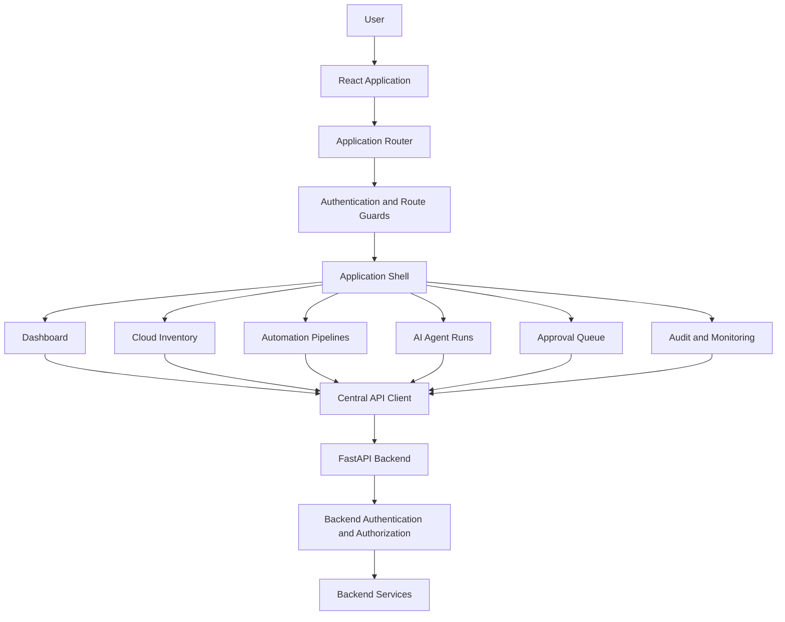

# OpsPilot Frontend Architecture

## Purpose
OpsPilot is a proposed multi-tenant AI-powered DevOps automation platform.
This document defines a frontend direction; actual implementation must follow
the repository and verified backend capabilities.

## Main UI areas
1. Authentication and session handling
2. Organization and workspace selection
3. Role-aware navigation
4. Overview dashboard
5. Cloud account connections and infrastructure inventory
6. Projects and repositories
7. CI/CD pipelines and automation jobs
8. AI agent orchestration and run monitoring
9. Approval queue
10. Audit logs and monitoring
11. Settings and integrations

## Proposed roles
- Platform Administrator
- Organization Administrator
- Workspace Administrator
- DevOps Engineer
- Developer
- Security Auditor
- Viewer

Confirm actual roles and permissions with the backend.

## Logical frontend architecture

## Data and security principles
- The backend is the source of truth for permissions and execution results.
- The frontend must not contain cloud provider secrets.
- Tenant-scoped views must refresh data when the active organization changes.
- API routes and payloads must be verified before integration.
- AI recommendations must be distinguished from actions that were actually executed.
- Destructive operations require backend authorization and appropriate confirmation.

## Design direction
Default dark theme:
- #0B1120 background
- #151F32 surface
- #6366F1 indigo
- #22D3EE cyan
- #A78BFA violet

Use neon accents selectively and preserve accessibility.

## Testing
Test authentication, role-aware navigation, tenant switching, API failures,
job states, approval flows, accessibility, responsive layouts, and production builds.

## Implementation status
This document describes the target architecture. It does not assert that
all listed screens, roles, endpoints, or workflows already exist.
